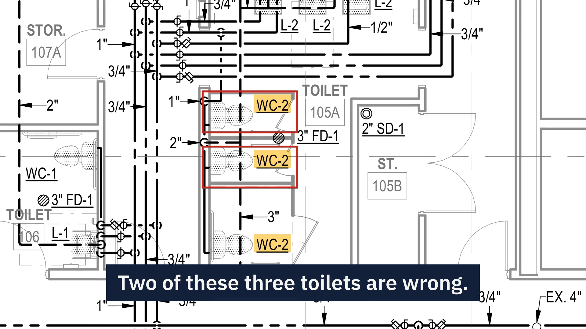
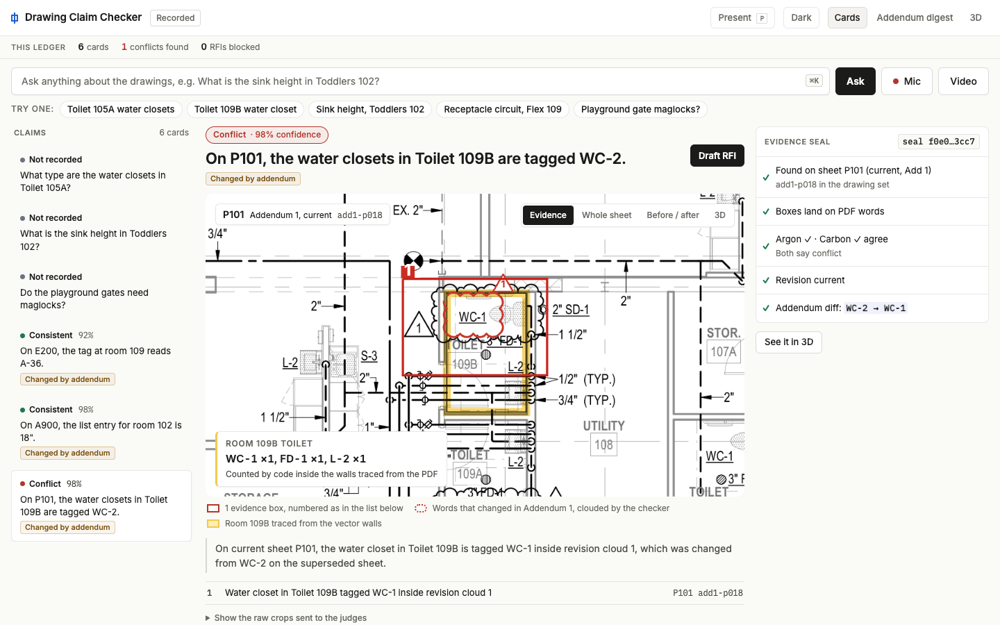
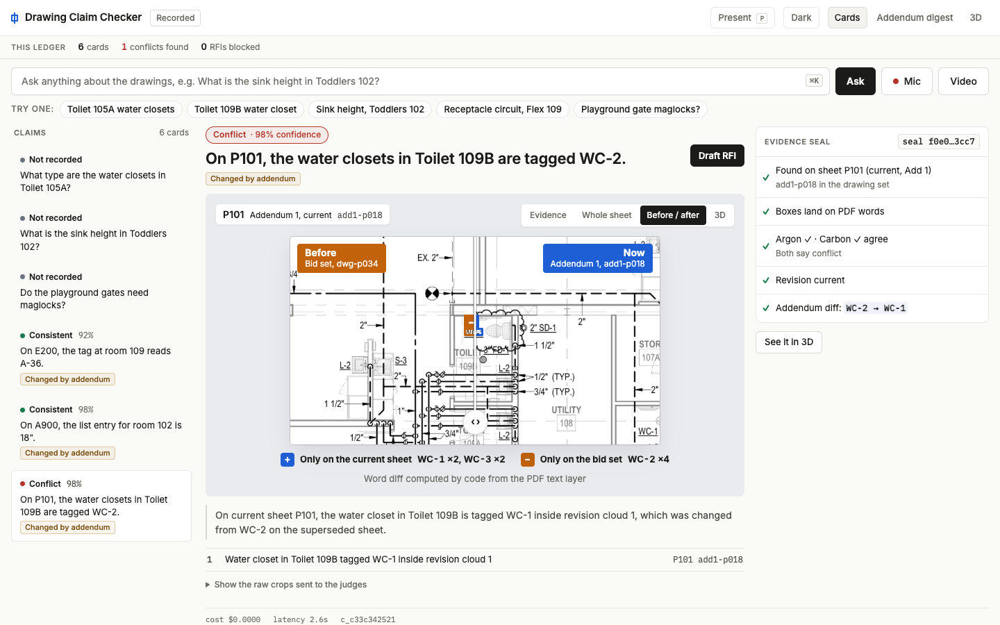
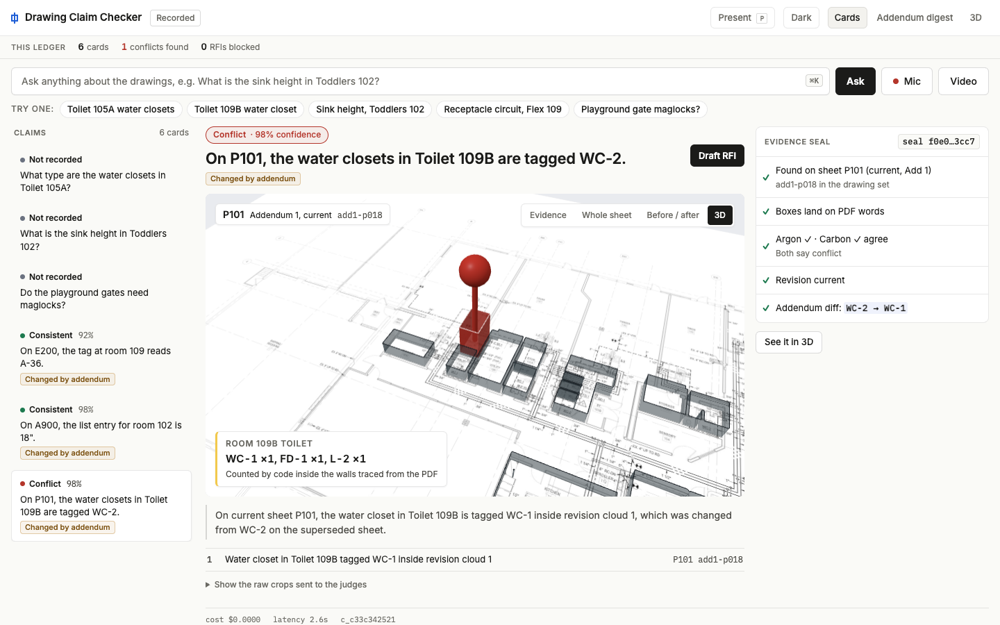
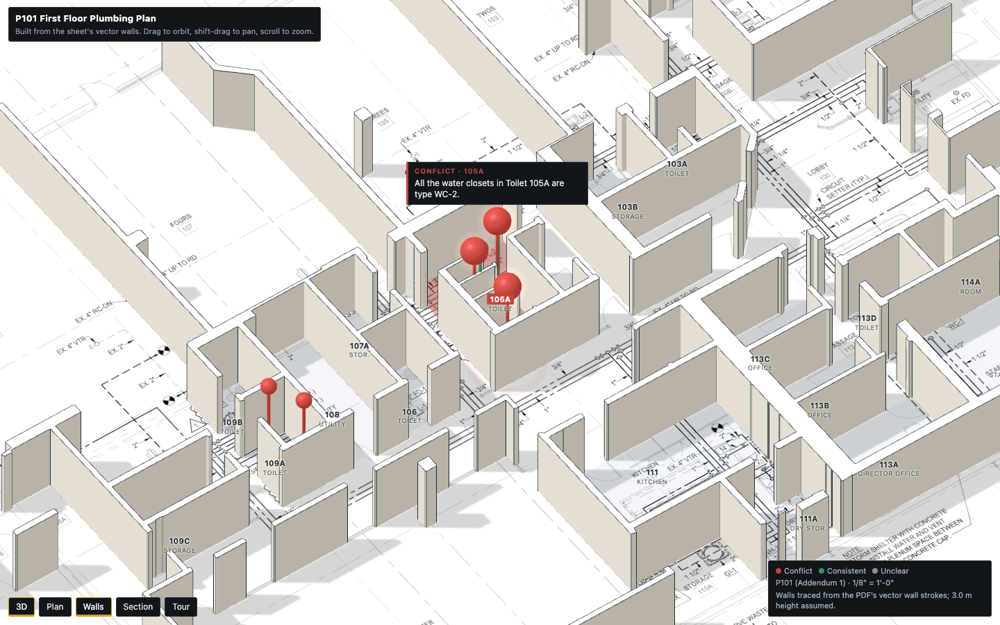
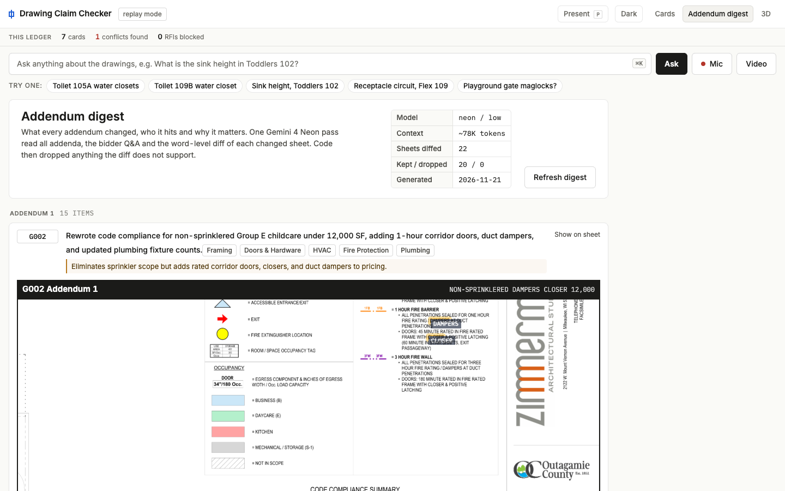
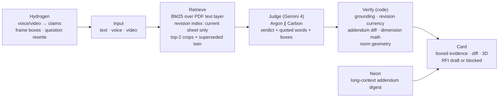

# SheetSight

*See what changed on the drawings, before you build or send the RFI.*

**Ask the current drawings anything. Get the answer boxed on the actual sheet, verified by code.**
Built entirely on Gemini 4, on a real public construction bid set.

[**Live demo**](https://drawing-claim-checker-g4.fly.dev) · [How it works](#how-it-works) · [Results](#results) · [Run it](#run-it-locally)



---

## The problem

### Everyone builds from the drawings. The drawings keep changing.

A building is designed on paper long before it exists: hundreds of pages of plans, details and schedules. Then
it passes through dozens of hands. The owner, the architect, structural, mechanical and electrical engineers, the
general contractor, and every subcontractor who prices, orders and installs a piece of it, across a project that
runs for years.

And the drawings **never stop changing.** Every revision goes out as an *addendum*: a bundle of replacement sheets
and answers to questions. The old sheets don't disappear. They sit in inboxes, on tablets, printed and pinned to
a wall in the site trailer. Somebody, somewhere, is always holding the wrong version.

### That gap costs real money, every single day

- **Rework.** A crew installs what the old sheet said. Weeks later someone notices. It gets torn out, re-ordered
  and re-installed, and the schedule slips while it happens.
- **RFIs.** When people aren't sure, they send the architect a formal question, a **Request for Information**,
  and wait. Each one is reported to cost about **$1,080 and 8 hours** to answer, and roughly **1 in 10 asks
  something the documents already answer** (Navigant RFI study, via
  [Procore](https://www.procore.com/jobsite/lower-the-cost-of-your-rfis); secondary source). Work stalls while
  the answer travels back through every party.
- **Delays compound.** A blocked question holds up a trade; that trade holds up the next. Each lost day is paid
  for in labour, equipment and penalties, in an industry where **margins are already razor thin.** One missed
  change can erase the profit on a scope of work.
- **Nobody is careless.** The information exists. It's buried in a 54-sheet set and two addenda that look almost
  identical, and nobody has time to diff them by eye.

### One building, for real

This YMCA childcare centre's **public bid set has 54 drawing sheets. Two addenda replaced 20 of them.**

On sheet P101, Addendum 1 quietly changed **two of the three toilets** in Toilet 105A from type WC-2 to WC-3. The
two versions are nearly impossible to tell apart. A plumber who orders from the bid set installs two wrong
toilets, and they get ripped out.

Multiply that by every sheet, every addendum, every trade, for the life of a project. **That is the problem.**

### What teams actually need

Not another chatbot that sounds confident. They need to ask *"is this still right?"* and get an answer they can
**check in five seconds**: the exact words, boxed on the current sheet, with what changed and why. And when the
answer can't be proven, the honest reply is *"unclear, look here"*, not a guess.

## What it does

| | |
|---|---|
| **Ask** | Type, speak, or film. "Which WC goes in Toilet 105A?" or "All the water closets in 105A are WC-2." |
| **See** | The verdict (*conflict / consistent / unclear*) with the evidence **boxed on the current sheet**, a before/after wipe of what the addendum changed, and the room traced from the drawing's walls. |
| **Trust** | Every word the model cites is checked by code against the PDF's own text layer. If it can't be proven, the answer is **unclear**, never a guess. |
| **Save an RFI** | If an addendum's Q&A already answers the question, it's blocked and the exact answer is quoted. |
| **Digest** | One long-context Gemini 4 Neon pass turns every addendum into a plain-English impact list by trade, each item verified against the real drawing diff. |
| **3D** | The sheet tilts into a 3D plan built from the drawing's **real vector walls**, with verdict pins on the evidence. Nothing in it is AI-generated geometry. |
| **Phone** | A SwiftUI iPhone app (`ios/`) films a sheet or a space, says the claim, and gets cards back. |

| Verdict card | Before / after | Sheet → 3D |
|---|---|---|
|  |  |  |

| 3D plan from vector geometry | Addendum digest |
|---|---|
|  |  |

## How it works

**Gemini proposes. Code disposes.**



| Gemini 4 model | Job |
|---|---|
| **Argon** | Primary judge. Reads the current sheet crop (plus the superseded one), returns verdict, the exact quoted words and `box_2d` boxes `[ymin, xmin, ymax, xmax]` on a 0–1000 scale. |
| **Carbon** | Independent second judge, in parallel. Disagreement means *unclear*. |
| **Hydrogen** | Voice → timestamped claims; video → claim + exact frame (then boxed with an image call); plain-English questions → checkable lookups with validated sheet hints; confirms when an addendum Q&A already answers an RFI. |
| **Neon** | Long context: every addendum narrative, 26 bidder Q&As and all sheet diffs in one ~77K-token call → the addendum digest. |

All roles run at thinking level LOW. In our comparison it matched higher levels on grounded accuracy, at lower latency.

**The verifier** (`verify.py`) is what makes answers trustworthy:
- **Grounding.** Each quoted word must sit inside its evidence box on the PDF text layer. A *conflict* must box the contradicting value (WC-3), not just repeat the claim; a *consistent* verdict must box every identifier the claim asserts.
- **Currency.** The evidence sheet must be the current revision after all addenda.
- **Dimensions.** Feet-inches, fractions and pairs are parsed and compared by code, against boxed quotes only.
- **Rooms.** Outlines are flood-filled from the drawing's vector wall strokes; evidence must lie inside the room the claim names. Tags inside each room are counted by code.
- **Silence is not a contradiction.** If the sheet never mentions what the claim names, the answer is *unclear*.

## Results

Live, end to end (`check()`: search → crop → Argon ∥ Carbon → verifier), scored with Wilson 95% intervals.
Held-out sets are frozen by sha256 (`eval/HELDOUT.md`) and were never used for tuning.

| Set (2026-11-21) | n | Correct | 95% CI | False alarms | Right when it answered |
|---|---|---|---|---|---|
| **Held-out v2** | 43 | **27 (62.8%)** | 48–76% | **0** | 100% |
| Held-out v1 | 17 | 9 (52.9%) | 31–74% | **0** | 100% |
| Dev v3 (tuning) | 111 | 79 (71.2%) | 62–79% | 3 → fixed* | 94.7% |

**0 false alarms across 60 held-out claims.** Misses are abstentions (*unclear*), which cost a person a glance, not a wrong build.
*The 3 dev false alarms were one pattern (a claim naming something the sheet never mentions); a prompt rule fixed it, re-checked on a dev subset at 19/19 with conflict recall unchanged.
A fresh frozen held-out v3 (51 claims) is in `eval/heldout_v3.json` for the next measurement.

**About 1,150 automated tests,** including adversarial suites written to break each module (Unicode dashes, NaN confidence, malformed requests, spend-cap races, cross-site requests, concurrent PDF rendering).

## Run it locally

```bash
python3.12 -m venv .venv && .venv/bin/pip install -r requirements.lock
./fetch_data.sh                          # 5 public PDFs → data/, checked against SHA256SUMS
.venv/bin/python ingest.py               # words + boxes, tiles, sheets.json
.venv/bin/python analyze_sheets.py       # sheet index: numbers, revisions, supersession
.venv/bin/python qa_index.py             # addendum Q&A index (RFI block)
export GEMINI_API_KEY=...                # never commit it; unset GOOGLE_API_KEY (the SDK prefers it)
.venv/bin/uvicorn app:app --port 8000    # → http://127.0.0.1:8000  (press P for Present mode)
.venv/bin/python -m pytest -q            # tests
```

| Env var | Meaning |
|---|---|
| `LLM_CACHE` | `readwrite` (default: replay recorded calls, record new ones) · `replay` (offline demo) · `off` |
| `LLM_RUN_CAP_USD` | Hard spend cap per run (default $5). Every Gemini call reserves its worst-case cost first. |
| `LLM_RUN_ID` | Names the run for the cap (default: one per UTC day). |

Evaluate: `python eval/run_eval.py eval/dev_v3.json --out build/metrics.json --workers 4 --label dev`
(it refuses to run a held-out file whose sha256 doesn't match).

## Repo map

| Path | What |
|---|---|
| `app.py` | FastAPI: `/api/check` (+ SSE stream), `/api/ask`, `/api/audio`, `/api/video`, `/api/rfi`, `/api/digest`, `/api/plan3d/<sheet>`, static UI |
| `check.py` · `verify.py` | Claim → card pipeline · the deterministic verifier |
| `search.py` · `rooms.py` · `plan3d.py` | BM25 retrieval · room geometry from vector walls · 3D plan data |
| `llm.py` · `roles.py` | The only Gemini gateway (cap, retries, record/replay, key scrubbing) · model roles |
| `ask.py` · `rfi.py` · `qa_index.py` · `digest.py` | Plain-English questions · RFI draft/block · addendum Q&A · Neon digest |
| `audio_claims.py` · `video_claims.py` · `video_frames.py` | Voice and video input |
| `ingest.py` · `analyze_sheets.py` | PDFs → words, tiles, revision index |
| `ui/` | Single-file web UI (sheet stage, wipe, 3D, Present mode); `ui/assets/plan3d.js` |
| `ios/SiteCapture.swiftpm` | iPhone capture app |
| `eval/` | Dev and frozen held-out sets, label audits, `run_eval.py` |
| `PLAN.md` · `CONTRACT.md` · `RESEARCH.md` · `MARKET.md` · `DEMO.md` | Plan, data contracts, sourced research, market notes, demo script |

## Honest limits

- One project's drawings. Accuracy on other firms' sets is untested.
- Vector PDFs only; scanned sheets would come back *unclear*.
- Room geometry resolves 19 labelled rooms on P101; open-plan areas stay unresolved (info only, never a veto).
- RFI cost figures are secondary sources, quoted as "reported".
- The iPhone app has run on one device; video input has been tested on a pan over a drawing, not jobsite footage.

## Security

Public data only. The UI renders model output through `textContent` only (no HTML sinks). The API key is read from
the environment and scrubbed from every error. Spend is capped in code; money-spending endpoints reject
cross-site requests. Nothing is sent to anyone without a human click.
